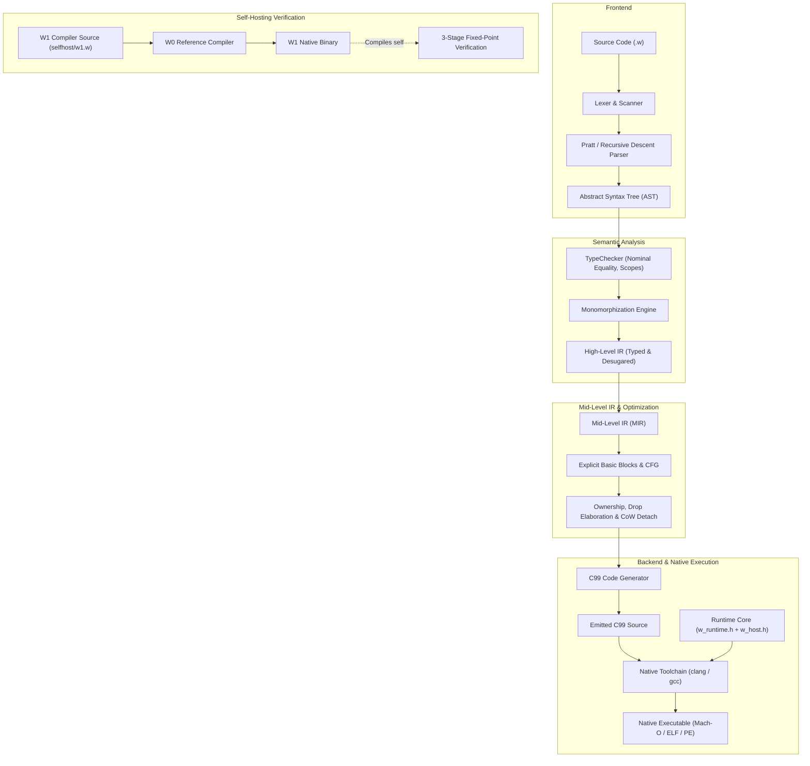

# W Programming Language

[](https://github.com/WashingtonYandun/W/actions/workflows/ci.yml)

<p align="center">
  
</p>

W is an experimental, statically typed programming language designed for native systems programming, CLI tooling, and high-performance applications. W0 compiles programs to portable C99 and combines deterministic reference counting (ARC), copy-on-write (CoW) value semantics, explicit error unions, and a controlled C interoperability layer.

The current release is `0.4.0a1` (alpha). W0 serves as the reference implementation, while W1 is the self-hosted compiler verified against a 4-engine parity suite.

---

## Architecture Overview

W follows a multi-stage compiler pipeline designed for verifiable transformations, explicit ownership modeling, and portable native code generation:



---

## Engine Parity & Conformance

Every core language feature and standard library capability is continuously verified across 4 execution engines:

| Engine | Role | Implementation | Status |
| :--- | :--- | :--- | :--- |
| **`interpreter`** | Reference behavior | Direct AST tree-walk evaluation in Python | 200/200 (100.0%) |
| **`ast`** | Secondary baseline | Direct AST to C99 code generation | 200/200 (100.0%) |
| **`hir`** | Primary production pipeline | Typed HIR &rarr; Verified MIR &rarr; C99 backend | 200/200 (100.0%) |
| **`w1`** | Self-hosted compiler | Native self-hosted W1 executable | 200/200 (100.0%) |

See [docs/ENGINE_PARITY_MATRIX.md](docs/ENGINE_PARITY_MATRIX.md) for full breakdown and feature classifications.

---

## Quick Start

### Windows: Instalador Autónomo

En las [descargas de W](https://github.com/WashingtonYandun/W/releases), descarga `w-<version>-windows-x64-setup.exe`:

1. Ejecuta el archivo `-setup.exe`.
2. Conserva la opción predeterminada de agregar W al `PATH`.
3. Abre una terminal nueva (PowerShell o CMD) y comprueba:

```powershell
w version
```

Crea un archivo `hello.w`:

```w
print("Hola desde W!")
```

Ejecuta o compila nativamente:

```powershell
w run hello.w
w build hello.w -o hello.exe
.\hello.exe
```

El instalador incluye Python privado y toolchain C portátil: funciona sin conexión, sin permisos de administrador y sin requerir Visual Studio.

### macOS & Linux: Source Checkout

Requisitos: Python 3.10 o superior y un compilador C99 (`clang` o `gcc`).

```sh
git clone https://github.com/WashingtonYandun/W.git
cd W
./w --version
./w run examples/01_hello_world.w
./w test
```

Compilación a binario nativo:

```sh
./w build examples/01_hello_world.w -o build/hello
./build/hello
```

---

## Language Highlights

### 1. Error Unions & Explicit Handling (`T ! E`)

Errors are first-class values and must be handled explicitly with `else` blocks:

```w
import std/parse

fn compute_ratio(raw: str, divisor: int) -> int ! str {
    let value = parse.parse_int(raw) else error {
        return Err("Invalid number format")
    }
    if divisor == 0 {
        return Err("Division by zero")
    }
    return Ok(value / divisor)
}

let result = compute_ratio("42", 2) else error {
    print("Error:", error)
    return
}
print("Ratio:", result)
```

### 2. Algebraic Data Types & Pattern Matching

```w
enum Status {
    Active,
    Suspended(reason: str),
    Terminated(code: int, message: str)
}

fn describe(s: Status) -> str {
    match s {
        Status.Active => "Account is currently active",
        Status.Suspended(reason) => "Suspended: " + reason,
        Status.Terminated(code, message) => "Terminated (" + str(code) + "): " + message
    }
}
```

### 3. Copy-on-Write (CoW) & Memory Management

Collections (lists, dictionaries, and structs) provide value semantics with zero-copy snapshot efficiency:

```w
let original = [1, 2, 3, 4]
let copy = original       // Shares underlying buffer via ARC (O(1))

copy.append(5)            // CoW detach occurs only on mutation!
print(original)           // [1, 2, 3, 4] - untouched
print(copy)               // [1, 2, 3, 4, 5]
```

### 4. Bounded Binary I/O & Scoped Resources

```w
import std/files
import std/resources

let file = files.open("data.bin", files.MODE_READ) else error {
    print("Could not open file:", error.operation)
    return
}

// Scoped lifecycle guarantees file closure even on errors:
resources.scope(file, |handle| => {
    let chunk = handle.read(4096) else error { return }
    print("Read bytes:", chunk.size())
})
```

---

## Standard Library Modules

W provides a focused, high-performance standard library:

| Module | Description | Key Functions & Types |
| :--- | :--- | :--- |
| **`std/buffer`** | Fast bounded byte storage | `Buffer`, `size()`, `get()`, `append()`, `close()` |
| **`std/files`** | Streaming file I/O | `File`, `open()`, `read()`, `write()`, `is_open()`, `close()` |
| **`std/fs`** | Portable filesystem operations | `exists()`, `size()`, `mkdir()`, `remove()`, `rename()` |
| **`std/parse`** | Strict string parsing | `parse_int()`, `parse_float()`, `parse_bool()` |
| **`std/text`** | String transformation utilities | `split()`, `join()`, `replace()`, `trim()`, `contains()` |
| **`std/path`** | Cross-platform path handling | `join()`, `dirname()`, `basename()`, `ext()` |
| **`std/resources`** | Deterministic resource scopes | `Resource`, `scope()`, `borrow()`, `close()` |
| **`std/algorithms`** | Functional primitives | `map`, `fold`, `sort` |

See [docs/STDLIB.md](docs/STDLIB.md) for full API reference and examples.

---

## CLI & Tooling

```text
w run <file.w>                 # Execute directly with reference interpreter
w check <file.w>               # Parse and type-check without code execution
w build <file.w> -o <bin>      # Compile to native standalone executable
w emit-c <file.w> -o <out.c>   # Generate human-readable portable C99 code
w fmt <file.w>                 # Format source while preserving comments and layout
w lsp                          # Launch Language Server Protocol daemon (stdio)
w test                         # Run full test suite across all 4 execution engines
w bench                        # Run self-hosted performance benchmarks
```

---

## Documentation

- [Language specification](SPEC.md): syntax, expressions, and semantics.
- [Type system design](docs/TYPE_SYSTEM_DESIGN.md): nominal checking, inference, and monomorphization.
- [HIR representation](docs/HIR_DESIGN.md) & [MIR representation](docs/MIR_DESIGN.md): intermediate forms and contracts.
- [Ownership & lifetimes](docs/OWNERSHIP_LIFETIME.md): ARC, copy-on-write, weak references, and drop elaboration.
- [Standard library reference](docs/STDLIB.md): complete API documentation for all standard modules.
- [Engine parity matrix](docs/ENGINE_PARITY_MATRIX.md): 4-engine test results and coverage.
- [FFI & C interoperability](docs/FFI_VALIDATION.md): calling C functions and descriptor ABI.
- [Known limits & boundaries](docs/KNOWN_LIMITS.md): current alpha constraints and guidelines.
- [Contributing guide](CONTRIBUTING.md) & [Security policy](SECURITY.md).

---

## Repository Layout

```text
├── checker/       # Semantic analysis, type checking, and monomorphization
├── codegen/       # C99 code generation and literal table emission
├── common/        # Shared platform adapters, locks, and version metadata
├── docs/          # Architecture RFCs, specifications, and design reports
├── error/         # Structured compiler diagnostic codes (W1000-W5000)
├── examples/      # Canonical code examples and language tours
├── formatter/     # Comment-preserving AST code formatter
├── hir/           # High-Level IR data structures and lowering
├── lexer/         # UTF-8 scanner, token definitions, and string escapes
├── mir/           # Mid-Level IR, CFG, place projections, and drop elaboration
├── node/          # AST node definitions
├── parser/        # Pratt parser and grammar rules
├── runtime/       # C99 runtime headers (w_runtime.h, w_host.h)
├── selfhost/      # Self-hosted W1 compiler source code (w1.w)
├── stdlib/        # Standard library implementations
├── tests/         # Differential testing harness and conformance suites
├── tooling/       # Language server (LSP) and developer utilities
└── tools/         # Validation, benchmarking, and packaging scripts
```

---

## License

W is distributed under the terms of the [MIT License](LICENSE).
