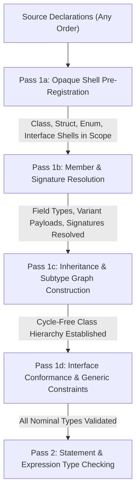

# Milestone C05: Centralized Type System, Container Invariance, and Order Independence

## Executive Summary
Milestone C05 formalizes W Language's type system guarantees across three core pillars: **Declaration Order Independence (Permutation Invariance)**, **Strict Container & Nominal Invariance** (per SPEC 4.1 & ADR-002), and **Robust Local Inference Protection**. These improvements eliminate forward-reference ordering bugs, prevent unsound subtyping in mutable collections, and prevent unconstrained or conflicting generic type variable assignments.

---

## 1. Architectural Reasoning & Motivation

### 1.1 The Forward Reference & Ordering Problem
Prior to C05, `TypeChecker` collected declarations in a single, top-down sequential pass (`_pass1_collect_declarations`). If a top-level function, class, or struct referenced another struct or enum declared later in the file, or if two types mutually referenced each other (e.g., `Node` containing `Edge` and `Edge` containing `Node`), the compiler failed immediately with `T002` ("Unknown type").

In modern programming languages, source-level declaration order should be semantically irrelevant:
$$\mathcal{T}(\text{Permute}(\text{Decls})) \equiv \mathcal{T}(\text{Decls})$$

### 1.2 Unsound Container Subtyping
Earlier versions of `WType.py` implemented covariant subtyping for lists (`ListType.is_assignable` allowed `list[Sub]` where `list[Super]` was expected). However, because lists and dictionaries in W are mutable, covariance allows writing invalid types into a collection through an aliased reference:
```w
class Animal {}
class Dog : Animal {}
class Cat : Animal {}

let dogs: list[Dog] = [Dog()]
let animals: list[Animal] = dogs // If allowed covariantly...
animals.append(Cat())            // ...now dogs contains a Cat! Memory & type corruption!
```
To guarantee sound type safety, mutable container types and generic compounds must be **strictly invariant**.

---

## 2. Multi-Pass Declaration Collection Architecture

In `checker/TypeChecker.py`, `_pass1_collect_declarations` has been refactored into a staged multi-pass architecture:



### 2.1 Pass 1a: Opaque Nominal Pre-Registration
Registers empty nominal shells into the type environment before inspecting any field types or function bodies:
- `StructType(name, fields={})`
- `EnumType(name, variants={})`
- `ClassType(name, super_name=..., members={})`
- `InterfaceType(name, methods={})`
- Generic template declarations (`_generic_structs`, `_generic_enums`, `_generic_functions`)
- Module import symbols

### 2.2 Pass 1b: Member and Signature Resolution
With all nominal type names pre-registered in the environment, field types, enum variant payloads, and function signatures are resolved. Forward references and mutual references now find their target type shells cleanly without `T002` errors.

### 2.3 Pass 1c: Inheritance Graph Resolution
Establishes `super_type` links on `ClassType` instances and detects circular inheritance graphs using cycle detection before method dispatch tables are constructed.

### 2.4 Pass 1d: Interface Compliance & Generic Constraints
Verifies that classes implementing interfaces satisfy method signatures and ensures type constraints on generic declarations are validated against fully realized nominal types.

---

## 3. Strict Invariance for Mutable Containers & Nominal Types

### 3.1 Formal Invariant Rules
In `checker/WType.py` and `checker/TypeInterner.py:is_assignable`:

1. **Lists:**
   $$\text{list}[T_1] \le \text{list}[T_2] \iff T_1 = T_2$$
   `list[Dog]` is strictly **not** assignable to `list[Animal]`.

2. **Dictionaries:**
   $$\text{dict}[K_1, V_1] \le \text{dict}[K_2, V_2] \iff K_1 = K_2 \land V_1 = V_2$$

3. **Nominal Structs & Generic Specializations:**
   $$\text{Struct}_A[T_1, \dots, T_n] \le \text{Struct}_B[U_1, \dots, U_m] \iff A = B \land n = m \land \forall i, \, T_i = U_i$$

4. **Nominal Enums & Generic Specializations:**
   $$\text{Enum}_A[T_1, \dots, T_n] \le \text{Enum}_B[U_1, \dots, U_m] \iff A = B \land n = m \land \forall i, \, T_i = U_i$$

### 3.2 Canonical Internees & Enum Type Arguments
`checker/TypeInterner.py` was extended so `EnumDef` records `type_args` and `template_name`. When generic enums (such as `Option[T]` or recursive `Tree[T]`) are monomorphized, their type arguments remain part of their canonical interner representation.

---

## 4. Local Inference Protection & Diagnostics

### 4.1 Empty Dictionary Invariant (`let d = {}`)
Unannotated empty dictionaries cannot determine key and value types. `TypeChecker` rejects `let d = {}` with diagnostic `[W2001]` / `T011`:
```w
let d = {} // ERROR: Cannot infer type of empty dictionary without context
```
Annotated declarations (`let d: dict[string, int] = {}`) or non-empty initializers remain valid.

### 4.2 Null Coalescing (`??`) Context Propagation
When evaluating `left ?? right`:
1. `left` must evaluate to `Option[T]`.
2. The inner payload type `T` is propagated down as the **expected type context** when checking `right` (`self._check_payload(expr.right, opt_inner)`).
3. Guarantees that expressions like `opt ?? [1, 2, 3]` correctly infer `list[int]` without requiring redundant explicit annotations on the right-hand fallback.

### 4.3 Conflicting Generic Inference Detection
When calling generic functions or instantiating generic structs:
```w
fn choose[T](a: T, b: T) -> T { return a }
let x = choose(1, "hello")
```
Unification now detects when a type variable `T` has already been bound to `int` and encounters a conflicting assignment `string`. Instead of silently overwriting or adopting an unsound union, `TypeChecker` raises `[W2001]`:
```
[W2001] file.w:2:9 - Conflicting types inferred for generic parameter 'T': int vs string
```

---

## 5. Verification & Test Coverage

### 5.1 Test Suite: `test_c05_types_inference.py`
A comprehensive, dedicated test suite exercises each architectural guarantee:
1. **Permutation Invariance:** Mutual structs, mutual enums, and functions calling forward-declared functions in reverse order.
2. **Container Invariance:** Rejection of `list[Dog]` to `list[Animal]`, dict invariance, and struct invariance.
3. **Contextless Inference Protection:** Rejection of `let d = {}` and verification of `??` context propagation.
4. **Conflicting Generic Inference:** Detection of conflicting generic arguments in function calls and struct initializers.
5. **Generic Enum Argument Preservation:** Verification that `EnumDef` retains all specialized type arguments in `TypeInterner`.
6. **Native C99 Execution with Sanitizers:** End-to-end execution across both AST C99 and HIR C99 backends under Clang AddressSanitizer and UndefinedBehaviorSanitizer (0 leaks, balanced memory allocations).

### 5.2 Conformance Results
- **Unit Suite:** `test_c05_types_inference.py` passed 100%.
- **Conformance Suite:** `./w test` passed **400/400 tests (100%)**.
- **Integration Profile:** `python3 tools/ci_conformance.py --profile=integration` passed **102/102 cases**.
- **Sanitizer Profile:** `python3 tools/ci_conformance.py --sanitize` passed **102/102 cases** with 0 memory errors or leaks.
