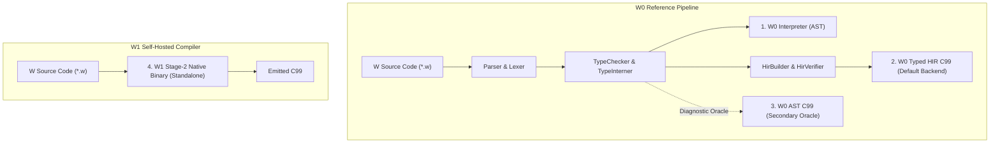

# Engine Feature Parity Matrix & Implementation Boundaries

> **Milestone D01 Contract:** W explicitly documents the exact support status of each compiler engine across all language features. Releases do not claim universal parity while self-hosting limitations exist.

---

## 1. Compiler Engines & Architectural Roles

The W Language toolchain maintains four distinct execution targets, each with a defined architectural role:

1. **W0 Interpreter (`runtime/Interpreter.py`):** Canonical reference AST tree-walking interpreter.
2. **W0 Typed HIR (`hir/HirCCodeGen.py`):** Primary production compiler backend (default since Milestone C06).
3. **W0 AST C99 (`codegen/CCodeGen.py`):** Secondary C99 oracle retained for differential fuzzing and cross-engine verification.
4. **W1 Self-Hosted (`selfhost/w1.w`):** Native Stage-2 standalone compiler binary compiled via 3-stage bootstrap fixed-point.

---

## 2. Feature Parity Matrix

The following table summarizes current compiler support across all 107 test fixtures in the repository corpus:

| Feature Category | Fixtures | W0 Interpreter | W0 AST C99 | W0 Typed HIR (Default) | W1 Self-Hosted C99 | Status / Tracking |
| :--- | :---: | :---: | :---: | :---: | :---: | :--- |
| **`core`** | 91 | ✅ 91/91 | ✅ 91/91 | ✅ 91/91 | ✅ 91/91 | Stable &bull; 100% Parity |
| **`generics`** | 15 | ✅ 15/15 | ✅ 15/15 | ✅ 15/15 | ⏳ 0/15 | Pending Milestone D02 |
| **`checked_modules`** | 1 | ✅ 1/1 | ✅ 1/1 | ✅ 1/1 | ⏳ 0/1 | Pending Milestone D02 |
| **Total Corpus** | **107** | **107/107 (100%)** | **107/107 (100%)** | **107/107 (100%)** | **91/107 (85.0%)** | **Full W0 Parity &bull; Core W1 Subset** |

---

## 3. Detailed Feature Breakdown

### 3.1 Core Language & Control Flow (`core`)
- **Status:** **100% Parity** across all 4 engines.
- **Coverage:** 91 fixtures (positive runtime fixtures, control flow, functions, OOP contracts, recursion, and error diagnostics).
- **Features Included:**
  - Arithmetic, logic, bitwise, and comparison expressions.
  - While loops, range loops (`for i in 0..10`), break, continue, and scope cleanup.
  - If/elif/else expressions and statements.
  - Pattern matching (`match`) over primitives, tuples, and enums.
  - Native strings with byte-level length and UTF-8 iteration.
  - First-class tuple indexing and construction.

### 3.2 Value Semantics & Copy-on-Write (`core`)
- **Status:** **100% Parity** across all 4 engines.
- **Coverage:** Tested under `tests/runtime/list_cow.w`, `struct_cow.w`, `value_semantics_cow.w`, and `cow_telemetry.w`.
- **Features Included:**
  - Pure value semantics for `list[T]`, `dict[K, V]`, and user `struct` instances.
  - Path-copying detach asymptotics: $O(\text{shared path})$ complexity verified across all 4 engines.

### 3.3 Nominal OOP & Polymorphism (`core`)
- **Status:** **100% Parity** across all 4 engines.
- **Coverage:** Tested under `tests/runtime/oop_classes.w` and `examples/07_oop_polymorphism.w`.
- **Features Included:**
  - Single inheritance `class` hierarchies with `super` constructor calls.
  - Nominal `interface` contracts with explicit `implements`.
  - Dynamic method dispatch via vtables and `WVal` object wrappers.
  - Field encapsulation (`public` vs `private`).

### 3.4 Deterministic Memory & Weak References (`core`)
- **Status:** **100% Parity** across all 4 engines.
- **Coverage:** Tested under `tests/runtime/weak_references.w`, `memory_counters_verification.w`, and B03 leak suites.
- **Features Included:**
  - Deterministic `CleanupScope` ARC with zero tracing garbage collector pauses.
  - Control block architecture (`WWeakControl`) with separate strong and weak reference counters.
  - Safe `weak(obj)` handles and `upgrade(w)` returning `Option[T]`.
  - Verified under AddressSanitizer and LeakSanitizer: 0 memory leaks for acyclic and weak-broken structures.

### 3.5 Monomorphized Generics & ADTs (`generics`)
- **Status:** **Supported in W0** (15/15); **Unsupported in W1** (0/15).
- **Remediation Target:** **Milestone D02**.
- **Explanation:**
  - W0 supports generic functions `fn id[T]`, generic structs `struct Box[T]`, generic enums `enum Option[T]`, recursive ADTs (e.g. `enum Tree[T]`), and layout graph cycle checking (`W2011`).
  - W1 (`selfhost/w1.w`) currently expects standard parentheses after identifiers and does not parse type parameters (`[` / `]`), failing with `expected 'LPAREN', found '['`.
  - Porting the TypeInterner, monomorphization engine, and generic lowering to W1 is the core objective of Milestone D02.

### 3.6 Checked Compilation Sessions & Modules (`checked_modules`)
- **Status:** **Supported in W0** (1/1); **Unsupported in W1** (0/1).
- **Remediation Target:** **Milestone D02**.
- **Explanation:**
  - W0 implements whole-program `CompilationSession` with arena deduplication and diamond import caching.
  - W1 operates as a single-file compiler or uses the bootstrap bundler (`tools/bundle_w1.py`) rather than native multi-module compilation sessions.

---

## 4. Bootstrap Fixed-Point vs. Full Language Parity

It is critical to distinguish between two distinct compiler guarantees:

1. **Bootstrap Fixed-Point (Deterministic Code Generation):**
   - The 3-stage bootstrap fixed-point ($\text{SHA256}(c_0) == \text{SHA256}(c_1) == \text{SHA256}(c_2)$) proves that the self-hosted compiler `selfhost/w1.w` is self-consistent and emits bit-for-bit identical C99 code across successive generations when compiling itself.
   - It **does not** prove that W1 accepts all language constructs present in W0.

2. **Full Language Parity:**
   - Full parity requires W1 to accept and correctly compile 100% of the surface language features, including generics, ADTs, and modular compilation sessions.
   - Full parity is the explicit goal of Phase D (specifically D02).

---

## 5. CI Execution Profiles & Quality Gates

The compiler test harness (`tools/ci_conformance.py`) enforces strict behavioral quality gates:

### 5.1 Integration Profile (`--profile=integration`)
- Evaluates all 102 corpus fixtures across all engines.
- Skips unsupported features on specific engines based strictly on `tests/engine_profiles.json`.
- **Requirement:** Every unsupported feature must carry an explicit, non-empty tracking reason pointing to its roadmap milestone.
- **Result:** Passes (102/102) if and only if all supported features pass without failure, while accurately reporting unsupported counts.

### 5.2 Release Profile (`--profile=release`)
- Evaluates all 102 corpus fixtures across all engines without allowing any unsupported exclusions.
- **Requirement:** Every engine must pass 100% of all fixtures.
- **Result:** Intentionally fails as long as W1 has unsupported features (`generics`, `checked_modules`), preventing deceptive releases that claim full self-hosting before D02 is complete.

---

## 6. Standalone W1 Execution Contract

When invoking W1 via `w build --backend=selfhost <file.w>` or `w build --selfhost <file.w>`:
- The command executes the native `w1_stage2` binary directly via `subprocess.run([w1_bin, input, output])`.
- **No W0 pre-check or pre-filtering is performed.**
- If the source file contains features unsupported by W1 (such as generics), the native W1 compiler itself parses, validates, and emits its own error messages directly.
