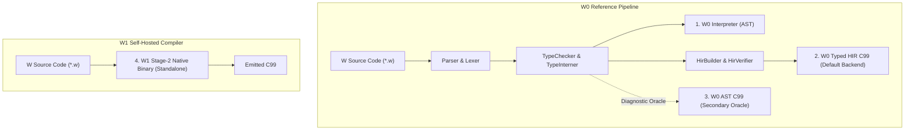

# Engine Feature Parity Matrix & Implementation Boundaries

> **Milestone D01 Contract:** W documents measured engine support for every fixture in the public core corpus. This matrix does not claim universal language parity.

---

## 1. Compiler Engines & Architectural Roles

The W Language toolchain maintains four distinct execution targets, each with a defined architectural role:

1. **W0 Interpreter (`runtime/Interpreter.py`):** Canonical reference AST tree-walking interpreter.
2. **W0 Typed HIR (`hir/HirCCodeGen.py`):** Primary production compiler backend (default since Milestone C06).
3. **W0 AST C99 (`codegen/CCodeGen.py`):** Secondary C99 oracle retained for differential fuzzing and cross-engine verification.
4. **W1 Self-Hosted (`selfhost/w1.w`):** Native Stage-2 standalone compiler binary compiled via 3-stage bootstrap fixed-point.

---

## 2. Feature Parity Matrix

The following table summarizes compiler support across the public core corpus. The counts are regenerated from `summary.json` by `tools/ci_conformance.py --matrix`, which reports measurements from the last verified run rather than restating `tests/engine_profiles.json`. Closures, FFI, generic OOP, stdlib and the LSP live in a separate expansion suite; see [EXPANSION.md](EXPANSION.md). Current project status and follow-up work are in [ROADMAP.md](ROADMAP.md).

<!-- GENERATED TABLE START -->

| Feature Category | Fixtures | W0 Interpreter | W0 AST C99 | W0 Typed HIR (Default) | W1 Self-Hosted C99 | Status / Milestone |
| :--- | :---: | :---: | :---: | :---: | :---: | :--- |
| **`core`** | 134 | ✅ 134/134 | ✅ 134/134 | ✅ 134/134 | ✅ 134/134 | Declared supported |
| **`generics`** | 15 | ✅ 15/15 | ✅ 15/15 | ✅ 15/15 | ✅ 15/15 | Declared supported |
| **`checked_modules`** | 1 | ✅ 1/1 | ✅ 1/1 | ✅ 1/1 | ✅ 1/1 | Declared supported |
| **`error_unions`** | 8 | ✅ 8/8 | ✅ 8/8 | ✅ 8/8 | ✅ 8/8 | Declared supported · F03 |
| **Total Verified** | **158** | **158/158 (100.0%)** | **158/158 (100.0%)** | **158/158 (100.0%)** | **158/158 (100.0%)** | _measured_ |

Regenerate with `python3 tools/ci_conformance.py --matrix`, which reads `summary.json`
from an actual run of `python3 tools/ci_conformance.py` over the corpus. These are
measurements of the four engines, not a restatement of `tests/engine_profiles.json`;
`--matrix` reports `STALE` if the summary no longer covers the current corpus.

The `error_unions` category exercises subset propagation, runtime identity checks for
struct, enum and scalar errors, and exhaustive `else err` matching. Six negative fixtures
cover invalid alternatives, missing alternatives, incompatible propagation and unsupported
payload subpatterns. The dedicated ownership fixture covers managed error payloads,
failed guards, CoW copies, direct Result widening and propagation cleanup. F03 passes all eight cases across the four engines.

The `core` category includes five fixtures that pin runtime **panic** behaviour
(`panic_division`, `panic_modulo`, `panic_index`, `panic_dict_key`,
`panic_entrypoint_error`). Those declare the diagnostic they must raise with a
`# RUNTIME_PANIC: Wxxxx` marker instead of expected stdout, and every engine must report
that exact code and terminate non-zero. They exist because panic behaviour was the one
axis no fixture covered, which is how the interpreter and the two C backends were able to
disagree on it without any test noticing. `assignment_expression` covers the opposite
gap: a construct the checker accepted while the HIR backend rejected it.

<!-- GENERATED TABLE END -->

---

## 3. Detailed Feature Breakdown

### 3.1 Core Language & Control Flow (`core`)
- **Status:** **100% Parity** across all 4 engines.
- **Coverage:** 98 fixtures (positive runtime fixtures, control flow, functions, OOP contracts, recursion, and error diagnostics).
- **Features Included:**
  - Arithmetic, logic, bitwise, and comparison expressions.
  - While loops, range loops (`for i in 0..10`), break, continue, and scope cleanup.
  - If/elif/else expressions and statements.
  - Pattern matching (`match`) over primitives, tuples, and enums.
  - Native strings with byte-level length and UTF-8 iteration.
  - First-class tuple indexing and construction.

### 3.2 Value Semantics & Copy-on-Write (`core`)
- **Status:** **100% Parity** across all 4 engines.
- **Coverage:** Tested under `tests/runtime/list_cow.w`, `struct_cow.w`, `value_semantics_cow.w`, and `cow_telemetry.w`.
- **Features Included:**
  - Pure value semantics for `list[T]`, `dict[K, V]`, and user `struct` instances.
  - Path-copying detach asymptotics: $O(\text{shared path})$ complexity verified across all 4 engines.

### 3.3 Nominal OOP & Polymorphism (`core`)
- **Status:** **100% Parity** across all 4 engines.
- **Coverage:** Tested under `tests/runtime/oop_classes.w` and `examples/07_oop_polymorphism.w`.
- **Features Included:**
  - Single inheritance `class` hierarchies with `super` constructor calls.
  - Nominal `interface` contracts with explicit `implements`.
  - Dynamic method dispatch via vtables and `WVal` object wrappers.
  - Field encapsulation (`public` vs `private`).

### 3.4 Deterministic Memory & Weak References (`core`)
- **Status:** **100% Parity** across all 4 engines.
- **Coverage:** Tested under `tests/runtime/weak_references.w`, `memory_counters_verification.w`, and B03 leak suites.
- **Features Included:**
  - Deterministic `CleanupScope` ARC with zero tracing garbage collector pauses.
  - Control block architecture (`WWeakControl`) with separate strong and weak reference counters.
  - Safe `weak(obj)` handles and `upgrade(w)` returning `Option[T]`.
  - Verified under AddressSanitizer and LeakSanitizer: 0 memory leaks for acyclic and weak-broken structures.

### 3.5 Monomorphized Generics & ADTs (`generics`)
- **Status:** **15/15 corpus fixtures pass on all four engines**; F01 is complete.
- **Coverage:** Generic functions and structs, generic enums and `Option`/`Result`, recursive ADTs, imported generic specialization, and stable constraint/layout-cycle diagnostics (`W2011`, `W2001`).
- This is measured corpus coverage, not a guarantee that every possible generic program has identical behavior on W0 and W1.

### 3.6 Checked Compilation Sessions & Modules (`checked_modules`)
- **Status:** **1/1 corpus fixture passes on all four engines**; F01 is complete.
- W0 implements whole-program `CompilationSession` with arena deduplication and diamond import caching.
- W1 loads imports, enforces public names, qualifies module identities, and detects cycles before feeding a flattened token stream to its compiler. This passes the checked-module fixture, including imported generic specialization, but does not provide W0's shared typed declarations or specialization cache.

### 3.7 Closed Error Unions (`error_unions`)
- **Status:** **8/8 fixtures pass on all four engines**: two runtime fixtures and six
  invalid fixtures rejected consistently; F03 is complete.
- `T ! E1 | E2` is restricted to the Result error channel. `?` widens an error only when
  the source set is a subset of the declared target set. `else err` patterns check scalar
  tags or exact nominal struct/enum identity, including module-qualified types, and
  require exhaustive coverage.
- Generic types, classes, collections, tuples, functions and other compound alternatives
  remain outside the supported contract.

---

## 4. Bootstrap Fixed-Point vs. Core Corpus Parity

It is critical to distinguish between two distinct compiler guarantees:

1. **Bootstrap Fixed-Point (Deterministic Code Generation):**
   - The 3-stage bootstrap fixed-point ($\text{SHA256}(c_0) == \text{SHA256}(c_1) == \text{SHA256}(c_2)$) proves that the self-hosted compiler `selfhost/w1.w` is self-consistent and emits bit-for-bit identical C99 code across successive generations when compiling itself.
   - It **does not** prove that W1 accepts all language constructs present in W0.

2. **Core Corpus Parity:**
   - Corpus parity means every fixture in this 158-case public corpus passes on every engine, with no unsupported exclusions.
   - It does not claim W1 parity for the separate E expansion suite or every possible source program. F01 closed the 16 exclusions that previously existed; F03 added measured error-union coverage.

---

## 5. CI Execution Profiles & Quality Gates

The compiler test harness (`tools/ci_conformance.py`) enforces strict behavioral quality gates:

### 5.1 Integration Profile (`--profile=integration`)
- Evaluates all 130 corpus fixtures across all engines.
- Skips unsupported features on specific engines based strictly on `tests/engine_profiles.json`.
- **Requirement:** Every unsupported feature must carry an explicit, non-empty tracking reason pointing to its roadmap milestone.
- **Result:** Passes (158/158) if and only if all supported features pass without failure, while accurately reporting unsupported counts.

### 5.2 Release Profile (`--profile=release`)
- Evaluates all 130 corpus fixtures across all engines without allowing any unsupported exclusions.
- **Requirement:** Every engine must pass 100% of all fixtures.
- **Result:** Fails on any unsupported fixture or behavioral mismatch. It currently passes all 130 fixtures on all four engines with no exclusions; F03 is complete.

---

## 6. Standalone W1 Execution Contract

When invoking W1 via `w build --backend=selfhost <file.w>` or `w build --selfhost <file.w>`:
- The command executes the native `w1_stage2` binary directly via `subprocess.run([w1_bin, input, output])`.
- **No W0 pre-check or pre-filtering is performed.**
- If the source file uses a feature outside W1's measured subset, the native W1 compiler itself parses, validates, and emits its own error messages directly.
