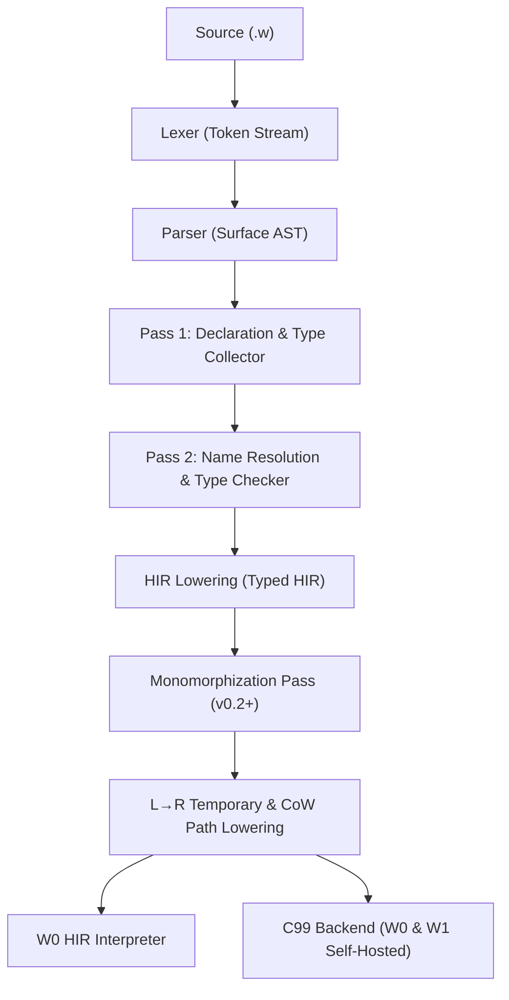

# W Language Architecture: Typed High-Level IR (`HIR`) Design

**Status:** Implemented & Default Production Backend (`C06`, `D01-D06` / `ADR-009`)  
**Scope:** Compiler Middle-End (`AST → Name Resolution → Type Checking → Typed HIR → HirVerifier → Backends`)

---

## 1. Problem Statement & Architectural Motivation

In `W v0.1.0` and `v0.1.1`, both the reference toolchain (`W0` in Python) and the self-hosted compiler (`W1` in `selfhost/w1.w`) operate directly on the surface Abstract Syntax Tree (`AST`):

```text
Source (.w) ──► Lexer ──► Surface AST ──► TypeChecker ──► Interpreter / C99 CodeGen
```

While direct AST traversal was sufficient to bootstrap `W1` and validate core semantics, it creates four structural risks as the language evolves toward **Generics (`v0.2`)**, **Function Types (`v0.3`)**, and **Closures (`v0.4`)**:

1. **Repeated Semantic Disambiguation in Backends:**
   Surface syntax contains overloaded constructs that only become unambiguous after type checking:
   - `User("Ada")` (constructor call) vs `compute("Ada")` (function call);
   - `State.Active` (enum variant) vs `user.name` (struct field) vs `account.balance` (class field) vs `math.sin` (module member);
   - `obj.run()` via concrete class hierarchy vs `intf.run()` via dynamic interface dispatch;
   - `+` on `int` (wrapping 64-bit two's complement), `float` (IEEE-754 `binary64`), or `str` (UTF-8 concatenation).
2. **Evaluation-Order & Temporary Lowering Duplication:**
   In `v0.1.1`, enforcing strict left-to-right (`L→R`) evaluation order across `gcc` (x86_64) and `clang` (ARM64) required manually binding call expressions to statement-level temporaries (`WVal _tN = ...;`) in both `codegen/CCodeGen.py` and `selfhost/w1.w`.
3. **Copy-on-Write (CoW) Path Semantics:**
   Deeply nested value mutations (`matrix[0].append(99)` or `grid.rows[1][0] = 5`) must detach every shared value container (`list`, `dict`, `struct`) along the lvalue access path until reaching a `class` reference boundary. Encoding this rule in HIR eliminates the risk of divergence between the interpreter and C99 codegen.
4. **Monomorphization Target for Generics (`v0.2`):**
   Monomorphizing generic `struct`, `enum`, `class`, and `fn` templates directly over untyped surface AST nodes is brittle because identifier scopes and method resolutions are not yet bound to canonical `SymbolId` and `TypeId` handles.

---

## 2. Target Compiler Pipeline



### Contratos implementados y límite de la representación

1. Cada expresión y patrón lleva un `TypeId` del arena comprobado y un `Span`.
2. Los bindings léxicos llevan `SymbolId`; llamadas directas, builtins, colecciones y
   métodos virtuales tienen targets distintos. Los slots virtuales se canonicalizan por
   nombre y aridad, se verifican contra la firma y se consumen en la emisión. Las
   proyecciones conservan nombres e información de campo: todavía no hay un layout
   físico completamente bajado ni se eliminó toda resolución textual del backend.
3. `HirAssignment(target, value, type_id, span)` produce el valor asignado y evita
   reconstruir el target como lectura. El verificador exige un destino direccionable.
   `HirAssign` sigue representando la sentencia. `HirSequence` conserva efectos ordenados
   cuando hace falta; los temporales y el cleanup se materializan en la emisión C.
4. `CollectionCallTarget` requiere receptor list/dict compatible. `VirtualCallTarget`
   requiere método, firma, clase y slot coherentes; `super` usa despacho estático.
5. `HirTryPropagate`, `HirCoalesce`, `HirElseHandle` y los nodos de control conservan
   estructura de expresiones. No son bloques básicos ni terminadores MIR. El análisis
   compartido de salidas comprueba fallthrough, incluido match parcial y ausencia de tail.
6. `CowPath` conserva metadata de las proyecciones; la preparación de destinos del
   emitter fija índices e identidad antes del RHS y resuelve slots después. El ownership
   completo todavía no está representado como operaciones de una IR independiente.

ADR-017 fija estos contratos. Las secciones de modelo siguientes contienen notación de
diseño; las clases ejecutables canónicas son `hir/HirNodes.py`.

---

## 3. Core HIR Data Model

### 3.1 Identifiers & Metadata
```text
struct Span {
    file_id: u32
    line: u32
    col: u32
}

type SymbolId = u32   # Unique per lexical binding (local, param, global fn, module)
type TypeId   = u32   # Interned canonical type index (see TYPE_SYSTEM_DESIGN.md)
```

### 3.2 Top-Level Module & Declarations (`HirModule`)
```text
struct HirModule {
    file_path: str
    types: list[HirTypeDecl]       # Structs, Enums, Interfaces, Classes
    functions: list[HirFnDecl]     # Top-level functions and lowered methods
}

enum HirTypeDecl {
    Struct(TypeId, fields: list[HirFieldDef])
    Enum(TypeId, variants: list[str])
    Interface(TypeId, methods: list[HirMethodSig])
    Class(
        type_id: TypeId,
        superclass: TypeId?,
        interfaces: list[TypeId],
        fields: list[HirFieldDef],
        methods: list[HirMethodImpl]
    )
}

struct HirFnDecl {
    symbol_id: SymbolId
    name: str
    type_params: list[TypeId]      # Empty after v0.2 monomorphization
    params: list[HirParam]
    return_type: TypeId
    body: HirBlock
    span: Span
}
```

### 3.3 Statements (`HirStmt`)
| HIR Statement Node | Purpose |
| :--- | :--- |
| `HirLet(symbol_id, type_id, is_mut, init_expr, span)` | Local variable declaration with resolved `SymbolId` and `TypeId` |
| `HirBindTemp(temp_id, type_id, init_expr, span)` | Compiler-generated temporary enforcing strict `L→R` evaluation |
| `HirAssign(lvalue_path, value_expr, span)` | Assignment to a mutable local, index, struct field, or object field |
| `HirWhile(cond_expr, body_block, span)` | Loop with boolean-verified condition |
| `HirForList(elem_bindings, list_expr, body_block, span)` | Desugared list iteration over a cloned/retained `ListType` value |
| `HirReturn(value_expr, span)` | Explicit function/method return |
| `HirBreak(span)` / `HirContinue(span)` | Loop control transfer (statically verified `loop_depth > 0`) |
| `HirExprStmt(expr, span)` | Expression evaluated for side effects |

### 3.4 Expressions (`HirExpr`)
Every `HirExpr` contains `{ kind: HirExprKind, type_id: TypeId, span: Span }`:

| `HirExprKind` Variant | Lowered Semantics |
| :--- | :--- |
| `ConstInt(i64)` / `ConstFloat(f64)` / `ConstBool(bool)` / `ConstStr(str)` / `ConstNone` / `ConstUnit` | Typed scalar constants |
| `LocalRef(SymbolId)` / `ThisRef(TypeId)` | Direct reference to a local variable, parameter, or method receiver |
| `UnaryOp(UnaryKind, operand)` | `NegInt` (wrapping), `NegFloat`, `NotBool` |
| `BinaryOp(BinaryKind, left, right)` | Type-specialized operator (`AddInt`, `AddFloat`, `ConcatStr`, `DivIntTrunc`, `ModIntTrunc`, `EqVal`, `EqRef`, etc.) |
| `Sequence(statements, value)` | Ordered effects embedded at the expression site, followed by a value; preserves conditional evaluation for `and`, `or`, and `??` |
| `ConstructStruct(TypeId, fields: list[(FieldIdx, HirExpr)])` | Value-type `struct` initialization in canonical field declaration order |
| `ConstructEnum(TypeId, variant_idx: u32)` | Enum variant construction |
| `ConstructObject(TypeId, args: list[HirExpr])` | Unified heap-allocated `class` construction + `init` invocation (replaces both `Class(...)` and `new Class(...)`) |
| `ConstructList(elem_type: TypeId, elems: list[HirExpr])` | Homogeneous list literal construction |
| `ConstructDict(key_type: TypeId, val_type: TypeId, entries)` | Homogeneous dictionary literal construction (`key_type` verified non-float) |
| `ConstructTuple(elem_types: list[TypeId], elems: list[HirExpr])` | Tuple value construction |
| `DirectCall(fn_symbol: SymbolId, type_args: list[TypeId], args: list[HirExpr])` | Static function call |
| `BuiltinCall(BuiltinId, args: list[HirExpr])` | Typed runtime intrinsic (`Print`, `LenStr`, `LenList`, `LenDict`, `SliceStr`, `Ord`, `Chr`, `Bytes`, `ReadFile`, `WriteFile`) |
| `MethodCall(dispatch: DispatchKind, receiver: HirLValueOrExpr, method_name: str, args: list[HirExpr])` | Dispatched method call (`ListAppend`, `ListPop`, `ListClear`, `DictGet`, `ClassMethod`, `SuperMethod`, `InterfaceMethod`) |
| `FieldRead(kind: FieldAccessKind, object: HirExpr, field_name: str)` | Disambiguated `StructField` vs `ClassField` read |
| `IndexRead(kind: IndexKind, object: HirExpr, index: HirExpr)` | Disambiguated `ListIndex`, `StrScalarIndex`, or `DictLookup` (returns `V?`) |
| `TryPropagate(kind: TryKind, operand: HirExpr)` | Explicit early-return unwrap for `T?` (`TryOptional`) or `T ! E` (`TryResult`) |
| `Coalesce(opt_expr: HirExpr, fallback_expr: HirExpr)` | Short-circuiting optional unwrap (`??`) |
| `ElseHandle(operand: HirExpr, err_symbol: SymbolId?, handler: HirBlock)` | In-place `else err { ... }` recovery |
| `If(cond: HirExpr, then_block: HirBlock, elifs, else_block: HirBlock?)` | Typed conditional expression/statement |
| `Match(subject: HirExpr, arms: list[HirMatchArm])` | Exhaustiveness-checked pattern match |

---

### 3.5 Patrones resueltos de error

`HirErrorTypePattern(error_type_id, binding, type_id, span, type_name)` representa una
alternativa de una unión de errores. El TypeId de la alternativa gobierna la comparación
runtime y el binding recibe ese mismo tipo. `type_name` conserva el texto de fuente
para el dump; no interviene en la identidad nominal.

`HirEnumPattern` representa variantes enum y constructores Option/Result. No puede
representar alternativas de una unión de errores. El verificador rechaza mezclas de
esas representaciones antes de emitir C; ADR-015 registra el contrato.

## 4. Explicit Copy-on-Write (`HirCowPath`) Lowering

One of W's defining semantic guarantees is that **mutating a nested value container never mutates aliased value bindings**, whereas mutating a field through a `class` instance mutates the shared reference object.

In Typed HIR, any mutating target (`a[i][j] = x`, `b.rows[0].append(1)`, `s.inner.count = 2`) is lowered to a structured `HirLValuePath`:

```text
struct HirLValuePath {
    root: HirLValueRoot              # MutableLocal(SymbolId) | ClassObjectExpr(HirExpr)
    steps: list[HirPathStep]         # Ordered outer-to-inner projection steps
}

enum HirPathStep {
    StructField(field_name: str, struct_type: TypeId)   # Detach struct if refcount > 1
    ListIndex(index_expr: HirExpr, elem_type: TypeId)   # Detach list if refcount > 1
    DictKey(key_expr: HirExpr, val_type: TypeId)        # Detach dict if refcount > 1
    ClassField(field_name: str, class_type: TypeId)     # Reference boundary: NO CoW detach
}
```

### Lowering Rule at Class Reference Boundaries
When the TypeChecker / HIR Builder constructs an lvalue path from an expression $E$:
1. It walks $E$ from innermost projection to outermost base.
2. If it encounters a `ClassField` projection on a `ClassType` receiver, **that class instance becomes the `ClassObjectExpr` root** of the mutable path (no `let mut` required on the variable holding the class reference, and no CoW detachment on the class instance itself).
3. Any `StructField`, `ListIndex`, or `DictKey` steps *inside* that class field still perform CoW detachment on the value containers stored inside the object.
4. If no `ClassType` boundary is crossed, the root must be a `MutableLocal(SymbolId)` declared with `let mut` (otherwise `W3001` is emitted), and every `StructField` / `ListIndex` / `DictKey` step detaches its container when `refcount > 1`.

---

## 5. Evaluation Order Lowering (`L→R` Sequence Points)

Per `SPEC.md` Section 5.4, W guarantees strict left-to-right evaluation of all sub-expressions. Because C99 leaves function argument and binary operand evaluation order unspecified between sequence points, HIR lowering normalizes compound expressions into ordered statements. Effects that belong to an expression remain in a `Sequence(statements, value)` node and are emitted at that exact expression site. This is required for right operands of `and`, `or`, and `??`: the backend emits those sequences inside the conditional branch that evaluates the operand, so skipped operands cannot mutate state.

Ordinary call arguments and strict binary operands are still emitted left-to-right as ordered C statements before the consuming operation:

### Example
Surface W code:
```w
let y = add( bump(x), bump(x) * 2 )
```
Lowered HIR block statements:
```text
HirBindTemp(_t1: int = DirectCall(bump, [LocalRef(x)]))
HirBindTemp(_t2: int = DirectCall(bump, [LocalRef(x)]))
HirBindTemp(_t3: int = BinaryOp(MulInt, TempRef(_t2), ConstInt(2)))
HirBindTemp(_t4: int = DirectCall(add, [TempRef(_t1), TempRef(_t3)]))
HirLet(y: int = TempRef(_t4))
```
Both `gcc` and `clang` are forced by `;`-terminated C99 variable declarations to execute `_t1`, `_t2`, `_t3`, and `_t4` in exact deterministic sequence.

---

## 6. Implementation & Consolidation Status

Typed HIR adoption and stabilization is complete:

1. **Phase A / C02 (`docs/history/C02_COMPLETION.md`):**
   - Introduced `hir/HirNodes.py`, `hir/HirBuilder.py`, and `hir/HirVerifier.py`.
   - Full type decoration, SymbolId/FieldId resolution, desugared patterns and control flow.
2. **Phase C06 (`docs/history/C06_COMPLETION.md`):**
   - Established Typed HIR (`hir/HirCCodeGen.py`) as the primary default compiler backend for `w build` and `w emit-c`.
   - Retained AST C codegen as secondary differential oracle (`--backend=ast`).
3. **Phase D01–D06 / ADR-009 (`docs/adr/ADR-009-Consolidation-and-Parity-Contracts.md`):**
   - Enforced byte-for-byte C99 code generation determinism across random hash seeds.
   - Verified against AddressSanitizer and UndefinedBehaviorSanitizer across 107 fixtures.
   - Integrated compiler phase telemetry and memory peak reporting.
