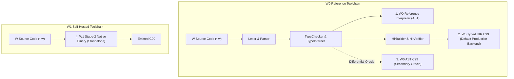

# ADR-009: Compiler consolidation, engine parity contracts, and deterministic verification

Status: Accepted (Formalizes Phase D deliverables D01–D06; establishes definitive contracts across all four compiler engines).

## 1. Context and Problem Statement

Early phases of the W Language development operated with informal assumptions regarding engine parity. While W0 acquired full-featured monomorphization, recursive ADTs, compilation sessions, and a typed High-Level Intermediate Representation (HIR), the self-hosted W1 compiler maintained a smaller subset necessary to compile itself. Furthermore, previous ADRs (ADR-002, ADR-004, ADR-005) did not explicitly distinguish between **bootstrap fixed-point reproducibility** and **universal language feature parity**.

This ADR unifies the architectural contracts, supersedes outdated assumptions from ADR-002 and ADR-004, formalizes OOP constructor and visibility guarantees (D03), defines semantic fuzzing and C99 determinism standards (D04), and establishes performance telemetry and benchmark contracts (D05).

---

## 2. Four-Engine Architectural Roles

The toolchain maintains four official execution targets, each with a strictly delimited responsibility:

1. **W0 Reference Interpreter (`runtime/Interpreter.py`):**
   Canonical AST tree-walking interpreter. Serves as the behavioral ground truth for language semantics and dynamic value semantics.
2. **W0 Typed HIR C99 (`hir/HirCCodeGen.py`):**
   Primary production backend (default since Milestone C06). Performs lowering into resolved symbols (`SymbolId`, `FieldId`, `VariantId`) and emits optimized, memory-safe C99.
3. **W0 AST C99 Transpiler (`codegen/CCodeGen.py`):**
   Secondary C99 transpiler retained as a differential oracle for fuzzing and verifying AST-to-HIR equivalence.
4. **W1 Stage-2 Self-Hosted Compiler (`selfhost/w1.w`):**
   Native standalone compiler compiled from source via a 3-stage bootstrap fixed-point:
   $$\text{SHA256}(c_0) == \text{SHA256}(c_1) == \text{SHA256}(c_2)$$

---

## 3. Parity Matrix vs. Bootstrap Fixed-Point Invariant

A fundamental distinction is established between two independent guarantees:
- **Bootstrap Fixed-Point:** Verifies deterministic self-compilation. Compiling `selfhost/w1.w` through W0 ($c_0$), compiling $c_0$ through Clang/GCC to produce Stage-1, compiling `w1.w` through Stage-1 ($c_1$), and compiling through Stage-2 ($c_2$) produces identical C code hashes.
- **Feature Parity Matrix (`docs/ENGINE_PARITY_MATRIX.md`):** Transparently records supported language features. W1 provides 100% parity across the `core` feature set (91/91 fixtures, 100%). Unsupported features (e.g. 15 generics fixtures awaiting monomorphization in W1) are publicly documented rather than masked.

---

## 4. Object-Oriented Programming (OOP) Invariants (D03)

1. **Constructor Safety (`W3004`):**
   - Constructor `fn init` must return `unit`.
   - If a class extends a base class with a constructor, `super.init(...)` must be invoked as statement 0, exactly once.
   - All fields declared by the class must be initialized within `init`. Reading or failing to initialize a field raises `W3004`.
2. **Visibility and Encapsulation (`W3002`):**
   - Members marked `private` cannot be accessed outside their declaring class scope (`W3002`).
   - Subclasses cannot override `private` methods of a superclass (`W3002`).
   - Dynamic dispatch tables (`w_dispatch__`) strictly register public methods (`m.is_public`), eliminating unauthorized polymorphic dispatch in C.

---

## 5. Semantic Fuzzing, Test Reduction & C99 Determinism (D04)

1. **Structured Semantic Fuzzing (`tests/fuzz/semantic_fuzzer.py`):**
   - Valid generator produces typed programs exercising ADTs, Copy-on-Write value semantics, OOP inheritance, and error propagation.
   - Negative mutator produces programs with identifiable faults (`W3004`, `W3002`, `W2001`, `W2004`, `W2003`), asserting consistent frontend rejection across all supported engines.
2. **Delta-Debugging Test Reducer (`reduce_failure`):**
   - When engine divergence or unexpected failures occur, 1-minimal delta debugging shrinks the program down to its minimal failing core, saving full JSON telemetry to `tests/fuzz/failures/`.
3. **Byte-for-Byte C99 Determinism:**
   - Emitted C99 must produce identical SHA256 hashes across repeated runs, regardless of `PYTHONHASHSEED`, memory layout, or temporary directories.

---

## 6. Performance Telemetry and Benchmarks (D05)

1. **Compiler `--stats` Telemetry:**
   - `check --stats`: Emits JSON telemetry to `stdout`.
   - `run --stats`, `build --stats`, `emit-c --stats`: Emits JSON telemetry strictly to `stderr`, preserving program `stdout` completely clean for testing and oracle consumption.
   - Telemetry tracks monomorphization requests/hits, codegen line/byte counts, compilation phase timings (`lex_ms`, `parse_ms`, `check_ms`, `hir_ms`, `codegen_ms`), and peak memory (`peak_rss_kb`).
2. **Benchmark Harness v0.2.0 (`bench/run_bench.py`):**
   - Compares W0 Interpreter, W0 Typed HIR C99 (production backend), and W1 C99.
   - Employs warmup iterations and takes the median of multiple runs to eliminate OS scheduling noise.
   - Verifies exact stdout equivalence: `stdout(Interpreter) == stdout(HIR C99) == stdout(W1 C99)`.

---

## 7. Consequences and Status

- Outdated claims of universal self-hosted generics parity are superseded by the versioned Parity Matrix.
- Memory safety, Copy-on-Write asymptotics, OOP invariants, and compiler determinism are fully covered by automated regression suites in CI.
