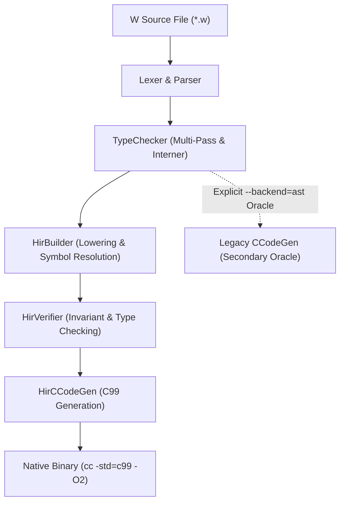

# Milestone C06: Default HIR Backend & Toolchain Consolidation

## Executive Summary
Milestone C06 completes Phase C of the W Language Compiler roadmap by establishing **Typed HIR (`Frontend -> Typed HIR -> HirVerifier -> HirCCodeGen -> C99`) as the primary and default native compilation route** across the toolchain. The legacy AST C99 backend (`codegen/CCodeGen.py`) is formally relegated to a diagnostic and differential verification oracle, eliminating dual maintenance of ownership, coercion, and cleanup rules.

---

## 1. Architectural Reasoning & Foundation

### 1.1 The Dual-Backend Problem
Previously, the W compiler maintained two parallel C99 code generators:
1. `codegen/CCodeGen.py`: Generated C directly from the surface `Program` AST.
2. `hir/HirCCodeGen.py`: Generated C from canonical, type-annotated, verified `HirModule`.

Maintaining both as primary engines created code duplication and divergence risks:
- Lifetime and temporary tracking had to be implemented twice.
- Operator short-circuiting and evaluated operand isolation had separate implementations.
- Monomorphized generic signatures had to support both AST and HIR lowering.

### 1.2 The Invariant: HIR as the Single Source of Truth
Under C06, all standard compilation commands (`w build`, `w emit-c`, `./w test`, and `main.py:run_pipeline`) target Typed HIR by default:


### 1.3 No Silent Fallbacks
A fundamental safety principle established in C06 is **the complete absence of silent fallbacks**. If `HirBuilder` or `HirVerifier` encounters an invalid construct, the compiler immediately raises a structured `WError` / diagnostic (`W9999` / `W2001`). The compiler **never** catches an internal HIR error and silently falls back to the AST generator, ensuring faults are detected and fixed rather than hidden.

---

## 2. CLI and Toolchain Interface

### 2.1 Explicit Engine Flags
In `main.py`, backend selection is centralized and explicit:
- `w build <file.w>`: Compiles to native binary via **Typed HIR** (default).
- `w emit-c <file.w>`: Emits C99 source via **Typed HIR** (default).
- `w build --backend=hir <file.w>` (or `--hir`): Explicitly selects Typed HIR.
- `w build --backend=ast <file.w>` (or `--ast`): Selects the legacy AST C99 generator for differential verification.
- `w build --backend=selfhost <file.w>` (or `--selfhost`): Selects the native Stage-2 W1 compiler binary.

### 2.2 Rejection of Invalid Backends
Passing an unknown backend (e.g. `--backend=llvm`) is rejected with exit code 1:
```
Error: Unknown backend 'llvm'. Valid backends: hir, ast, selfhost
```

---

## 3. HIR Lowering Hardening: Unit Return Normalization

During the validation of W1's self-hosting compiler source (`selfhost/w1.w`) under `HirBuilder`, a subtle semantic mismatch was identified and fixed:

### 3.1 The Problem
In surface syntax, functions returning `unit` (e.g. `fn parse_struct_decl() -> unit`) often end with an expression statement whose value is discarded (e.g. `expect_kind("RBRACE")` which returns a `Token`). In surface AST, this expression occupied `block.tail_expr`. When lowered to HIR, `block.tail_expr` retained type `Token`, causing `HirBindings` to raise a return type mismatch error:
```
[W9999] file.w:1923:1 - Function tail type does not match return type
```

### 3.2 The Normalization
In `hir/HirBuilder.py` (`_lower_fn_decl` and `_lower_method_decl`):
```python
if ret_tid == TYPE_UNIT:
    if body_hir.tail_expr is not None and body_hir.tail_expr.type_id != TYPE_UNIT:
        body_hir.statements.append(HirExprStmt(body_hir.tail_expr, body_hir.tail_expr.span))
        body_hir.tail_expr = HirConstUnit(TYPE_UNIT, body_hir.tail_expr.span)
    elif body_hir.tail_expr is None:
        body_hir.tail_expr = HirConstUnit(TYPE_UNIT, body_hir.span)
```
This guarantees that all unit functions in HIR have a canonical `HirConstUnit` tail expression, while any preceding expression with side effects is preserved in the statement sequence.

---

## 4. Verification and Conformance Metrics

### 4.1 Dedicated Test Suite: `test_c06_default_backend.py`
Exercises:
1. `test_default_backend_is_hir`: Verifies default emission matches HIR output.
2. `test_explicit_backend_flags`: Tests `--backend=hir`, `--backend=ast`, `--backend=selfhost`, and invalid backend rejection.
3. `test_unit_function_tail_normalization`: Validates statement sequence preservation and tail normalization in unit procedures.
4. `test_native_c99_execution_under_sanitizers`: Verifies end-to-end native compilation and execution with zero memory leaks under Clang AddressSanitizer and UBSan.

### 4.2 Test Suite Execution
- **Unit Suite:** `python3 -m tests.unit.test_c06_default_backend` passed 100%.
- **Conformance Suite:** `./w test` passed **401/401 tests (100%)**.
- **Integration Profile:** `python3 tools/ci_conformance.py --profile=integration` passed **102/102 cases**.
- **Sanitizer Profile:** `python3 tools/ci_conformance.py --sanitize` passed **102/102 cases** (0 memory errors, 0 leaks).
- **Differential Fuzzing:** `tests/differential/differential_test.py` validated both HIR and AST backends against randomized inputs.
